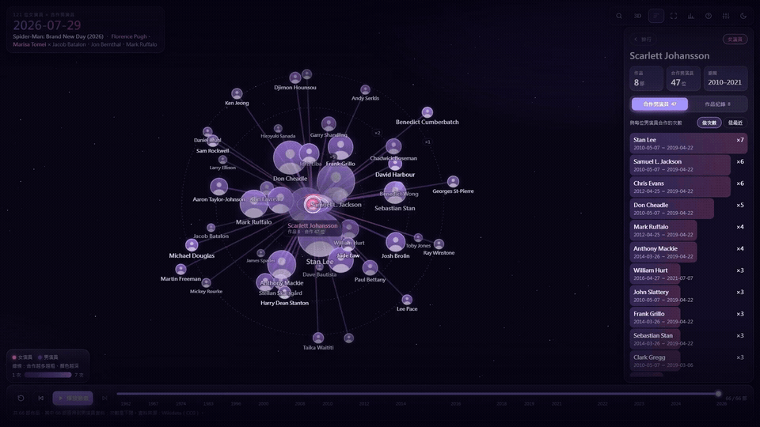

# 合作關聯圖（costars-tool）

把演員的合作作品畫成可互動的關聯圖：單一 HTML 檔、完全離線，用 Three.js（WebGL）與 anime.js 繪製。

- 2D／3D／4D：選一個人當原點，距離代表合作次數（對數刻度）；4D 的垂直軸是時間
- 3D／4D 選取一個人時，夥伴沿橢圓軌道繞著選取者運行，合作越少軌道越大、逼近卻碰不到中心，滑鼠停在人名上會暫停，繞行速度可在設定調整
- 放大鏡搜尋（漢字／假名／別名，↑↓／Enter）
- 時間軸可播放、拖曳、點年份跳轉
- 時間軸上一部／下一部（選人後＝跳到他出演的前／後一部）
- 統計面板：逐月累計的長條圖競賽與四張統計卡
- 互動導覽（工具列「？」）

## 先看示範

`site/index.html` 是用 **Wikidata（CC0）** 的電影演員資料做的公開示範（007、不可能任務、漫威系列），單一檔案，直接用瀏覽器開即可。
重新產生：`python -X utf8 demo/build_demo.py`（預設用 `demo/wikidata_cache.json`；`--refresh` 才會重新查詢 Wikidata，該服務限流每分鐘 1 次）。
要放上靜態空間（例如 Cloudflare Pages），把 `site/` 整個資料夾部署即可。

## 示範影片

[](docs/costars-demo.mp4)

24 秒示範，使用 Wikidata（CC0）的電影演員資料；配樂 Music by Sascha Ende at ende.app。

## 這個 repo 只有程式碼與示範資料

**不含任何爬回來的作品資料、快取或頭像。** 若要用自己的資料，請自行蒐集，並遵守來源網站的使用條款與著作權。

## 使用方式（自己的資料）

需求：Python 3、Node.js、一個以遠端偵錯埠啟動的 Chrome（預設 `127.0.0.1:9333`）。

1. 蒐集作品資料：`node wiki_collect.mjs --file names/<名單檔>`（每行一位，格式 `顯示名<TAB>候選寫法1|候選寫法2`）。程式內建節流（每次導航間隔 6 秒以上並加隨機抖動、定時長休息），遇到驗證頁只會等你自己通過，不會繞過。
2. 合併並建置：`python -X utf8 build_local.py`
   - 產生 `graph.html`，並複製到桌面；`--no-desktop` 不複製，`--no-merge` 不重新合併資料
3. 測試：`python -X utf8 -m unittest`、`node --test wiki_update.test.mjs`

## 增量更新（補新作）

第一次蒐集完之後，之後只需要補新作，不必整個重爬：

```
node wiki_collect.mjs --update                    # 全部已完成的人
node wiki_collect.mjs --update --only 名字1,名字2  # 只更新指定的人
node wiki_collect.mjs --update --max-pages 12     # 每人最多翻幾頁（預設 8）
```

- 只翻搜尋結果最前面幾頁（新到舊），遇到「整頁都已收錄」就停；沒有新作時每人只要 1 次導航。
- 新作品另存在 `data/updates/wiki_works_<名>.csv`，不動主 CSV 與頁面快取；`merge_multi.py` 會自動併入並以品番去重。
- 翻滿頁數上限仍有新作時會警告，請加大 `--max-pages` 或改用 `--extend <名字>`。
- 更新完再跑一次 `python -X utf8 build_local.py` 就會反映在圖上。

## 授權

[GNU AGPL-3.0](LICENSE)，Copyright (C) 2026 AVthing。
`vendor/` 內的 three.js、anime.js 為 MIT 授權，授權聲明隨檔附上（`three.LICENSE.txt`、`anime.LICENSE.txt`）。
示範資料來自 Wikidata（CC0）。
示範影片配樂：Music by Sascha Ende at ende.app。
